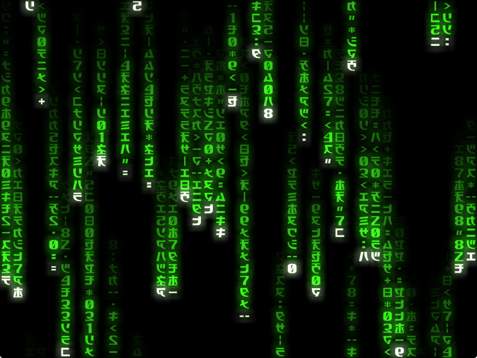
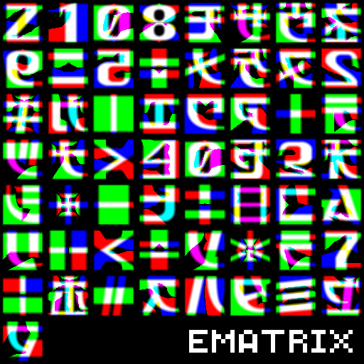

# ematrix
ematrix is a highly customizable digital rain effect.

Written in C99 using OpenGL 3.3 ([GLAD](https://github.com/Dav1dde/glad)), [GLFW](https://github.com/glfw/glfw) and [stb_image.h](https://github.com/nothings/stb/blob/master/stb_image.h). \
Own files of ematrix (files not located in `src/lib/` directory) is distributed under The MIT License (See [LICENSE](LICENSE) for details).

## Compiling
+ Install:
    - C99-compliant compiler and linker
    - GNU `make`
    - [GLFW](https://github.com/glfw/glfw)
+ Open a terminal in this directory and run `make`. The executable will be located in the `build/` directory.
    - Alternatively, run `make test` to compile and run ematrix immediately.

## About the effect


The effect utilizes glyphs provided by a font (See [Fonts](#fonts)) to render the rain (matrix of characters). \
Each character glyph changes randomly. Each character has brightness counter that decreases over time. \
A drop moves down each column of the rain. It increases the brightness counter of the characters it touches. Characters currently being touched by a drop are active and use separate layer of color map (See [Color map](#color-map)). \
Once a drop reaches the bottom edge of the window, it disappears for a random time before jumping to the top of window.

## Configuration
ematrix is configured using `key=value` options. 

You can pass options directly via the command-line argument `-key=value`, or specify a configuration file containing options using the `path/to/config` argument. \
**Note:** You can NOT add spaces after the equation mark (`=`).

### List of Options
<table>
<tbody>
    <tr>
        <td><b>Key</b></td>
        <td><b>Type</b></td>
        <td><b>Description</b></td>
        <td><b>Default</b></td>
        <td><b><i>Min</i></b></td>
        <td><b><i>Max</i></b></td>
    </tr>
    <tr>
        <td><code>Log</code></td>
        <td>int</td>
        <td>Logging verbosity level.<br>0: none, 1: errors, 2: errors+version, 3: verbose.</td>
        <td>2</td>
        <td>0</td>
        <td>3</td>
    </tr>
    <tr>
        <td><code>Screen</code></td>
        <td>int<br>index</td>
        <td>The index of the screen to open in fullscreen. If set to -1, fullscreen is disabled.</td>
        <td>-1</td>
        <td>-1</td>
        <td>32768</td>
    </tr>
    <tr>
        <td><code>ScreenW</code></td>
        <td>int<br>pixels</td>
        <td>Fullscreen width (0 for default).</td>
        <td>0</td>
        <td>0</td>
        <td>32768
    </tr>
    <tr>
        <td><code>ScreenH</code></td>
        <td>int<br>pixels</td>
        <td>Fullscreen height (0 for default).</td>
        <td>0</td>
        <td>0</td>
        <td>32768</td>
    </tr>
    <tr>
        <td><code>Resize</code></td>
        <td>bool</td>
        <td>If enabled, allows resizing the window and toggling fullscreen via the <code>KeyFullscreen</code> keybind.</td>
        <td>1</td>
        <td>0</td>
        <td>1</td>
    </tr>
    <tr>
        <td><code>AutoIcon</code></td>
        <td>bool</td>
        <td>If enabled, the fullscreen window will iconify when you click on another screen.</td>
        <td>0</td>
        <td>0</td>
        <td>1</td>
    </tr>
    <tr>
        <td><code>HideMouse</code></td>
        <td>bool</td>
        <td>If enabled, the mouse cursor will be hidden when clicked. It can be shown again via <code>KeyShowMouse</code> keybind.</td>
        <td>0</td>
        <td>0</td>
        <td>1</td>
    </tr>
    <tr>
        <td><code>W</code></td>
        <td>int<br>pixels</td>
        <td>Window width.</td>
        <td>800</td>
        <td>1</td>
        <td>32768</td>
    </tr>
    <tr>
        <td><code>H</code></td>
        <td>int<br>pixels</td>
        <td>Window height.</td>
        <td>600</td>
        <td>1</td>
        <td>32768</td>
    </tr>
    <tr>
        <td><code>Title</code></td>
        <td>string</td>
        <td>Window title.</td>
        <td colspan="3"><code>"ematrix"</code></td>
    <tr>
        <td><code>CharSize</code></td>
        <td>int<br>pixels</td>
        <td>Size of the rain characters.</td>
        <td>20</td>
        <td>1</td>
        <td>32768</td>
    </tr>
    <tr>
        <td><code>Border</code></td>
        <td>int<br>pixels</td>
        <td>Empty gap from window borders.</td>
        <td>4</td>
        <td>0</td>
        <td>32768</td>
    </tr>
    <tr>
        <td><code>Stretch</code></td>
        <td>bool</td>
        <td>Allows glyphs to be stretched for an ideal fit.</td>
        <td>1</td>
        <td>0</td>
        <td>1</td>
    </tr>
    <tr>
        <td><code>VSync</code></td>
        <td>int</td>
        <td>If set to 0, VSync is disabled. other values act as a divisor for the monitor's frame rate. Can be ignored if the GPU does not support VSync.</td>
        <td>1</td>
        <td>0</td>
        <td>32768</td>
    </tr>
    <tr>
        <td><code>Font</code></td>
        <td>string<br>path</td>
        <td>Path to a font file (PNG MSDF).<br>See <a href="#fonts">Fonts</a>.</td>
        <td colspan="3"><code>"embed://1.png"</code></td>
    </tr>
    <tr>
        <td><code>FontNum</code></td>
        <td>int</td>
        <td>The number of glyphs contained in the font file.<br>See <a href="#fonts">Fonts</a>.</td>
        <td>57</td>
        <td>1</td>
        <td>32768</td>
    </tr>
    <tr>
        <td><code>FontCols</code></td>
        <td>int</td>
        <td>The number of columns the glyphs are grouped into.<br>See <a href="#fonts">Fonts</a>.</td>
        <td>8</td>
        <td>1</td>
        <td>32768</td>
    </tr>
    <tr>
        <td><code>FontRows</code></td>
        <td>int</td>
        <td>The number of rows the glyphs are grouped into.<br>See <a href="#fonts">Fonts</a>.</td>
        <td>8</td>
        <td>1</td>
        <td>32768</td>
    </tr>
    <tr>
        <td><code>RandMin</code></td>
        <td>int<br>frames</td>
        <td>Minimum time between glyph randomization.</td>
        <td>200</td>
        <td>1</td>
        <td>32768</td>
    </tr>
    <tr>
        <td><code>RandMax</code></td>
        <td>int<br>frames</td>
        <td>Maximum time between glyph randomization.</td>
        <td>400</td>
        <td>1</td>
        <td>32768</td>
    </tr>
    <tr>
        <td><code>RandPow</code></td>
        <td>int</td>
        <td>Maximum steps of pow'ing.</td>
        <td>8</td>
        <td>0</td>
        <td>32768</td>
    </tr>
    <tr>
        <td><code>RandMul</code></td>
        <td>int<br>frames</td>
        <td>Each pow'ing step the time is multiplied by this.</td>
        <td>5</td>
        <td>1</td>
        <td>32768</td>
    </tr>
    <tr>
        <td><code>RandDiv</code></td>
        <td>int<br>frames</td>
        <td>Each pow'ing step the time is divided by this.</td>
        <td>4</td>
        <td>1</td>
        <td>32768</td>
    </tr>
    <tr>
        <td><code>DropMin</code></td>
        <td>int<br>frames</td>
        <td>Minimum period between falling drops.</td>
        <td>200</td>
        <td>1</td>
        <td>32768</td>
    </tr>
    <tr>
        <td><code>DropMax</code></td>
        <td>int<br>frames</td>
        <td>Maximum period between falling drops.</td>
        <td>400</td>
        <td>1</td>
        <td>32768</td>
    </tr>
    <tr>
        <td><code>OnlyInt</code></td>
        <td>bool</td>
        <td>If enabled, the drop period will be rounded to an integer ratio.</td>
        <td>1</td>
        <td>0</td>
        <td>1</td>
    </tr>
    <tr>
        <td><code>Trail</code></td>
        <td>int<br>0.01%</td>
        <td>Average trail length relative to window height. Faster drops have longer trails.</td>
        <td>8000</td>
        <td>0</td>
        <td>32768</td>
    </tr>
    <tr>
        <td><code>MinTrail</code></td>
        <td>int<br>chars</td>
        <td>Minimum trail length.</td>
        <td>6</td>
        <td>0</td>
        <td>32768</td>
    </tr>
    <tr>
        <td><code>Gauss</code></td>
        <td>int<br>pixels</td>
        <td>Gaussian blur factor.</td>
        <td>12</td>
        <td>1</td>
        <td>256</td>
    </tr>
    <tr>
        <td><code>Linear</code></td>
        <td>int<br>pixels</td>
        <td>Linear blur factor.</td>
        <td>3</td>
        <td>1</td>
        <td>32768</td>
    </tr>
    <tr>
        <td><code>BlurAlpha</code></td>
        <td>int<br>0.01%</td>
        <td>The brightness of the blur.</td>
        <td>5000</td>
        <td>0</td>
        <td>INT_MAX</td>
    </tr>
    <tr>
        <td><code>BlurPow</code></td>
        <td>int<br>0.01%</td>
        <td>The power applied to the blur. Higher values result in a sharper blur.</td>
        <td>10000</td>
        <td>0</td>
        <td>INT_MAX</td>
    </tr>
    <tr>
        <td><code>Noise</code></td>
        <td>int<br>0.01%</td>
        <td>The strength of blur noise.</td>
        <td>2000</td>
        <td>0</td>
        <td>10000</td>
    </tr>
    <tr>
        <td><code>NoisePow</code></td>
        <td>int<br>0.01%</td>
        <td>The power applied to the blur noise.</td>
        <td>20000</td>
        <td>0</td>
        <td>32768</td>
    </tr>
    <tr>
        <td><code>ColorX</code></td>
        <td>int<br>0.01%</td>
        <td>X resolution of the color map.</td>
        <td>1</td>
        <td>1</td>
        <td>32</td>
    </tr>
    <tr>
        <td><code>ColorY</code></td>
        <td>int<br>0.01%</td>
        <td>Y resolution of the color map.</td>
        <td>1</td>
        <td>1</td>
        <td>32</td>
    </tr>
    <tr>
        <td><code>ColorZ</code></td>
        <td>int<br>0.01%</td>
        <td>Z resolution of the color map.</td>
        <td>1</td>
        <td>1</td>
        <td>32</td>
    </tr>
    <tr>
        <td><code>R{X}.{Y}.{Z}</code></td>
        <td>int</td>
        <td>Red component of the color map pixel.<br>See <a href="#color-map">Color map</a>.</td>
        <td></td>
        <td>0</td>
        <td>255</td>
    </tr>
    <tr>
        <td><code>G{X}.{Y}.{Z}</code></td>
        <td>int</td>
        <td>Green component of the color map pixel.<br>See <a href="#color-map">Color map</a>.</td>
        <td></td>
        <td>0</td>
        <td>255</td>
    </tr>
    <tr>
        <td><code>B{X}.{Y}.{Z}</code></td>
        <td>int</td>
        <td>Blue component of the color map pixel.<br>See <a href="#color-map">Color map</a>.</td>
        <td></td>
        <td>0</td>
        <td>255</td>
    </tr>
    <tr>
        <td><code>Hex{X}.{Y}.{Z}</code></td>
        <td>hex color</td>
        <td>Color map pixel.<br>See <a href="#color-map">Color map</a>.</td>
        <td colspan="3"></td>
    <tr>
        <td><code>KeyFullscreen</code></td>
        <td>int<br>GLFW key</td>
        <td>Keybinding for fullscreen mode.</td>
        <td colspan="3">300 (F11)</td>
    </tr>
    <tr>
        <td><code>KeyShowMouse</code></td>
        <td>int<br>GLFW key</td>
        <td>Keybinding to show the mouse (which can be hidden via <code>HideMouse</code>).</td>
        <td colspan="3">256 (Escape)</td>
    </tr>
    <tr>
        <td><code>KeyQuit</code></td>
        <td>int<br>GLFW key</td>
        <td>Keybinding to quit the application.</td>
        <td colspan="3">81 (Q)</td>
    </tr>
    <tr>
        <td><code>Echo</code></td>
        <td>string</td>
        <td>Command.<br>Prints value to stdout.</td>
        <td colspan="3"></td>
    </tr>
    <tr>
        <td><code>Include</code></td>
        <td>string<br>path</td>
        <td>Command.<br>Parses the config file.</td>
        <td colspan="3"></td>
    </tr>
    <tr>
        <td><code>TryInclude</code></td>
        <td>string<br>path</td>
        <td>Command.<br>Parses the config file only if it exists.</td>
        <td colspan="3"></td>
    </tr>
</tbody>
</table>

*All keys are case-insensitive. You can also add spaces and dashes (`-`) anywhere within a key.* \
*Boolean fields are represented as integers (`0` or `1`) rather than `false` or `true`.* \
*Paths prefixed with `~/` are automatically resolved to the current user's home directory.* \
*Default values and MAX_COLOR_RES_\* and other constants can be modified in `src/config.c`.*

### Color map
The color map is a `ColorMapResX * ColorMapResY * (ColorMapResZ + 1)` 3D texture used to define character colors. \
Its X and Y dimensions match the character position, and the Z dimension represents brightness. An extra Z layer is used for active characters.

Default color map:
```
ColorResX=1
ColorResY=1
ColorResZ=1
Hex0.0.0=30D018
Hex0.0.1=D0FFC0 # Active characters
```

## Fonts
 \
*`embed/1.png`*

Font is a MSDF (Multi-channel Signed Distance Field) and must be PNG images. \
Glyphs should be laid out from left to right and top to bottom. \
If you provide custom font, you should also provide the total number of glyphs and the number of columns. \
Unused image space (free from glyphs) can contain anything.

## Code structure
+ `src/`: C sources of the project.
    + `src/ematrix.c`: ematrix itself.
    + `src/config.c`: Some configurable constants.
    + `src/lib/`: External libraries.
+ `embed/`: All files inside are embeded into the executable during build.
